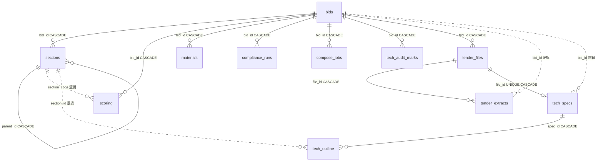
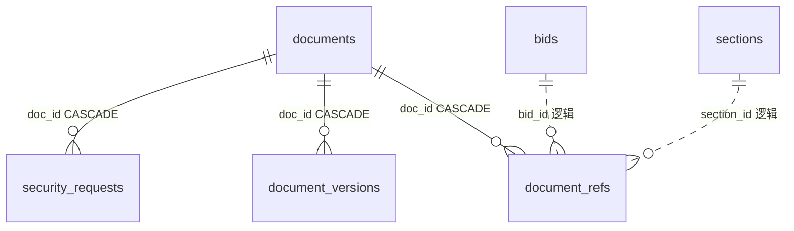

# XNIC 文档与标书智能工作台（中核西仪 · 本地开发环境）

基于《中核西仪_文档整理与标书编写系统》方案 demo 原型实现的 Python 全栈系统：
**Flask + SQLite + 原生 JS 前端**，无需外网与任何云服务，数据全部落盘本地。

## 运行方式

```bash
# 使用虚拟环境（已含 Flask）
C:\work\.venv\Scripts\python.exe app.py
# 浏览器访问 http://127.0.0.1:8009
# 换端口：C:\work\.venv\Scripts\python.exe app.py --port 8000
```

端口由 `app.py` 底部 `--port` 参数指定（默认 **8009**）。
数据库文件 `data/xnic.db`（首次启动自动建库并灌入演示数据）；上传附件存 `uploads/`，其中文档库附件按分类存 `uploads/documents/<分类>/`。表结构与表间关系见下节《数据库与表关系》。

## 六大模块

| 模块 | 功能 |
|---|---|
| 概览 | 文档/资质/标书统计卡、投标节点日历、资质到期预警、标书进度表 |
| 文档库管理 | 原文档中心升级，五个子页（支持 `#docs/子页` 直达，另支持 `#docs/doc/<id>` 打开详情、`#docs/preview/<id>` 直达预览、`#docs/trash` 打开回收站）：<br>① 文档台账——多格式上传（SHA-256 自动查重）、三维分类（类型×产品线×堆型）、公开/内部/商密三级密级、全文检索（名称/正文/标签/部门/责任人，含耗时）、状态筛选、**行内编辑/删除**、**回收站**；<br>② 受控版本——版本列表、新增版本自动设受控、历史版本一键回切、历史版本删除、**逐版本在线查看**；<br>③ 引用统计——被引 TOP8、按标书分布、最近引用明细（写入 document_refs）；<br>④ 僵尸文档——24 个月无访问自动标“待评估”，续用/归档/作废处置，不自动删除；<br>⑤ 密级审批——商密文档禁止直接下载，外发/降密须审批，批准后方可下载。 |
| 资质证照 | 资质台账、到期天数预警（≤90 天标橙、≤60 天标红）、新增资质；<br>**增删改查**——行内编辑（逐字段留痕、到期日校验、证书编号唯一）、删除两级制（回收站可恢复，彻底删除需二次确认且清除扫描件，审计保留）、状态筛选（有效/临期/已过期/已作废）与全文搜索；<br>**扫描件**——新增/编辑时可上传扫描件（PDF/图片，≤8MB），在线预览（叠“资质证照·仅限投标使用”水印）、未上传时预览友好拦截；<br>**换证管理**——更换扫描件自动清理旧文件；已作废资质仅可恢复后编辑；支持 `#certs/preview/<id>`、`#certs/trash` 直达。演示样张见 `tools/seed_cert_attachments.py`。 |
| 标书中心 | 状态/堆型筛选、新建标书（自动生成 9 章模板+评分矩阵） |
| 标书编制 | 章节树（增删改/拖拽/折叠）+ 正文（Markdown）/预览/原文要求三视图 + 评分响应/素材推荐/技术规格三面板；**AI 编写本节**（真实大模型，缺事实占位不编造）、**技术标编写 Agent**（后台任务批量成书）、**目录树对齐审核**（纵向响应 + 横向一致性 + 人工签认）、**全书 MD 预览 + 导出 .md / .docx 预审版**（Word 版 Mermaid 自动成图） |
| 合规检验 | 七类规则引擎：资质有效期 / ★条款偏离响应 / 暗标敏感词 / 业绩 PAC 完整性 / 签字盖章 / 报价一致性 / 时间程序，输出合规分与整改建议 |

## 目录结构

```
xnic_doc_bid/
├── app.py              # Flask 路由与静态页托管（含 compose-agent 任务接口）
├── database.py         # SQLite 连接、建表、演示数据种子、字段迁移与结构自愈
│                       #   （bids.baseline_card / sections.summary_ai / compose_jobs /
│                       #    sections.parent_id+level 目录树）
├── services.py         # 业务逻辑：AI 续写模拟、合规规则引擎、Markdown 归一化与整本 .md 渲染
├── llm_client.py       # OpenAI 兼容大模型客户端（多套配置/默认切换，密钥存 data/llm.json；
│                       #   百炼 Qwen3 自动注入 enable_thinking=false，区分可重试错误）
├── tender_agent.py     # 招标解析 Agent 五步管线（真实抽取）
├── tech_spec_agent.py  # 技术规格书独立解析 → 技术方案编写目录 → 技术标映射
├── composer.py         # 正文编写：五层上下文装配 + 动态角色卡 + Markdown 统一输出规范 + 摘要拆分 + 降级模板
├── tech_audit.py       # 对齐审核引擎（纯本地计算）：目录对齐/条目响应/指标落文/
│                       #   成文质量/横向一致性 → 对齐分与可签认审核项
├── tech_bid_agent.py   # 技术标编写 Agent（后台任务）：规划 → 逐节生成（超时自动降级）→
│                       #   自检重写 → 落库摘要 → 收尾对齐审核 → 任务单汇总
├── WordChapter.py      # [用户提供，未改动] Markdown→Word：DocumentConverter（mmdc 出图 +
│                       #   pypandoc）、PrettifyWord 排版、WordChapterExtractor 反解章节树
├── MermaidNodeFixer.py # [用户提供，未改动] Mermaid 节点圆括号修复，mmdc 渲染前预处理
├── tools/
│   ├── docx2pdf.py                # Word 排版引擎转 PDF（真实分页，COM 子进程）
│   ├── seed_attachments.py        # 为演示文档挂接样例附件（PDF/TXT/PNG，幂等）
│   └── seed_cert_attachments.py   # 为演示资质挂接证照扫描样张（PNG，幂等）
├── static/             # 前端（index.html / styles.css / app.js）
│   └── vendor/mermaid.min.js  # 本地 Mermaid 解析器（v8 UMD 单文件，离线可用，无 CDN 依赖）
├── data/               # xnic.db、预审版导出文件、排版稿缓存
├── uploads/            # 上传附件存储
│   ├── documents/      # 文档库附件，按分类分目录：<分类>/<uuid><扩展名>
│   └── <其他附件>      # 资质扫描件、招标文件等仍为扁平文件名
└── tests/test_api.py   # 接口用例（42 组；日常改动只跑改动点的单点用例）
```

## 数据库与表关系

**单文件 SQLite**：`data/xnic.db`（`database.py` 的 `DB_PATH`，可用环境变量 `XNIC_DB_PATH` 覆盖；文档库附件实体存 `uploads/documents/<分类>/`、其余附件存 `uploads/`，库里只存 `stored_path` / `sha256` / `file_size`）。`connect()` 每次连接执行 `PRAGMA foreign_keys = ON`、`timeout=15`；`init_db()` 顺序为 `SCHEMA`（**19 张表 + 11 个显式索引**）→ `seed()`（演示数据）→ 六个幂等迁移 `migrate()` / `migrate_certs()` / `migrate_tender()` / `migrate_sections_ai()` / `migrate_sections_tree()` / `migrate_document_upload_paths()`（补列 + 历史回填 + 目录树结构自愈 + 文档附件按分类迁移），`settings.doc_lib_v2` / `settings.tender_v1` / `settings.doc_upload_categories` 是「一次性回填已执行」的标记键。`idx_sections_parent` 特意放在 `migrate_sections_tree()` 里而非 `SCHEMA`——老库补列前在 `SCHEMA` 建该索引会报「列不存在」。**建表与补列只在 `database.py`，业务代码不建表**；重复执行 `init_db()` 安全。

> 关联分两类：**实线 / 声明外键** = DDL 里写了 `REFERENCES ... ON DELETE CASCADE`，删父行自动级联；
> **虚线 / 逻辑关联** = 只有列、由应用层 JOIN 或字符串匹配维护，**没有声明外键，删父行不会级联**。
> 下面字段清单以 `database.py` 的 `SCHEMA` 与迁移字典（`DOC_COLUMNS` / `CERT_COLUMNS` / `migrate_*`）为准，实测当前库 19 张表。

### 关系总览

**① 标书编制主线**（实线 = 声明外键级联，虚线 = 应用层逻辑关联）



**② 文档库与引用**



图中未画出的独立表：`certificates`（资质证照）、`term_dict`（全局术语）、`settings`（KV 配置）、`audit_logs`（只追加审计，靠 `entity_type + entity_id` 多态指向任意实体）。另有 `tender_files.parent_id → tender_files.id` 自引用（澄清差异版指向基准版），它只是业务上的版本指针，**没有声明外键**；`sections → sections` 才是真正带 `ON DELETE CASCADE` 的自引用外键。

### 表清单 · 标书主线（7 张）

| 表 | 作用 | 关键字段 | 约束 / 索引 |
|---|---|---|---|
| `bids` | 标书主档，一个投标项目一行 | `name/owner/reactor_type/due_date/status/progress/page_count/signature_complete/deviation_total/deviation_responded`；`baseline_card` 为锚点章提炼的全书基线卡（Agent 五层上下文之一） | PK `id` |
| `sections` | 章节树 + 原文要求 + AI 正文 | **`parent_id`**（父章节 id，组根为 `NULL`）、**`level`**（树深度，组根 = 1）、`code/title/group_name`（商务标 / 技术标 / 报价标）、`sort_order`、`status`（未开始 / 编制中 / 已完成）、`content` = 原文技术要求骨架、`content_ai` = **Markdown 正文**、`summary_ai` = 章节摘要、`ai_model/ai_written_at/ai_generated` | FK `bid_id` CASCADE + **自引用 FK `parent_id` CASCADE**；`UNIQUE(bid_id,code)`；`idx_sections_bid(bid_id,sort_order)`、`idx_sections_parent(parent_id,sort_order)` |
| `scoring` | 评分矩阵，逐项挂到章节 | `item/score/section_code/sort_order` | FK `bid_id` CASCADE；`idx_scoring_bid` |
| `materials` | 素材推荐 | `name/similarity/source/updated_at` | FK `bid_id` CASCADE |
| `compliance_runs` | 七类规则合规检验历史 | `score/result_json`（JSON）/`created_at` | FK `bid_id` CASCADE |
| `compose_jobs` | 技术标编写 Agent 的任务单、进度与统计 | `status`（`running/pausing/canceling/paused/interrupted/done/failed/canceled`）、`total/done_n/failed_n/skipped_n`、`current_code/current_title`、`model/tokens_prompt/tokens_completion/llm_calls/retries/rewrites`、`instructions/overwrite/section_ids`（章节 id JSON 数组）、`result`（JSON）、`audit_score/audit_verdict/audit_open`、`error`、`started_at/finished_at` | FK `bid_id` CASCADE；`idx_compose_jobs_bid(bid_id,id)`；服务重启把 `running/canceling/pausing` 改为 `interrupted`，`paused` 保留以便续跑 |
| `tech_audit_marks` | 对齐审核项的人工签认 / 豁免 / 重开 | `item_key`（审核引擎生成，如 `outline:<id>`、`skel:<id>`）、`verdict/note/user/updated_at` | FK `bid_id` CASCADE；`UNIQUE(bid_id,item_key)`；`idx_tech_audit_bid` |

#### 目录树结构：`parent_id` 是真值，`code` 是派生展示

| 项 | 说明 |
|---|---|
| `parent_id` | `INTEGER REFERENCES sections(id) ON DELETE CASCADE`；组根（如 `2.1`）为 `NULL`。**父子关系以它为准**，不再靠 `code` 前缀推断；直接删父行由数据库级联清掉整棵子树 |
| `level` | 树深度，组根 = 1、子节 = 2、孙节 = 3；与 `code` 的段数一致（`2.1` → 1，`2.1.3` → 2） |
| `code` / `sort_order` | 仍由 `app._renumber_sections()` 按整棵树重编：**`code` = 展示 / 导出 / 正文引用用的编号，`sort_order` = 深度优先顺序**；重编时同步写回 `parent_id` / `level` |
| 写入点 | `database.create_default_sections()`、`app.py` 的新增章节 / 插入本节 / 技术规格同步新建章节、目录树拖拽重排，全部显式写 `parent_id` / `level` |
| 读取点 | 前端 `buildSecTree()`、后端 `_tree_from_sections()`、`composer` 祖链层与后代汇总、`tech_audit._subtree()`、`app._subtree_ids()` 均沿 `parent_id` 递归；历史/手工数据缺 `parent_id` 时才用 `code` 前缀兜底 |
| 迁移 | `database.migrate_sections_tree()`：老库 `ALTER TABLE` 加两列 → 按**同标书**的 `code` 前缀回填 → 按父链重算 `level`；每次启动幂等自愈（清悬空 / 自指 / 跨标书 `parent_id`，补未挂父的历史行）。生产库实测 330 行回填后 0 错挂、0 孤儿 |

> 仍保留的已知债点：`scoring.section_code` / `document_refs.section_code` / `compose_jobs.current_code` 存的是**编号字符串**，拖拽重编 `code` 后不会自动回填（本次未改）。若需彻底消除，把这些列改为存 `section_id` 外键、展示时 JOIN 出 `code`。

### 表清单 · 招标文件解析（5 张）

| 表 | 作用 | 关键字段 | 约束 / 索引 |
|---|---|---|---|
| `tender_files` | 登记的招标文件 / 澄清答疑 | `kind`（招标文件 / 澄清答疑）、`version_label`（基准版 / 差异版）、`parent_id`（自引用）、`page_count/declared_total/status/locked_at/parse_report/stored_path`、`deleted_at/deleted_by/delete_reason`（软删除） | FK `bid_id` CASCADE；`idx_tender_files_bid(bid_id,id)` |
| `tender_extracts` | 解析出的抽取条目（量最大） | `category`（资格条件 / 评分办法 / ★条款 / 废标条款 / 技术参数 / 交付期 / 保证金 / 份数装订 / 澄清截止）、`title/content/page/para/score_value/confidence`、`status`（待确认 / 已确认 / 已驳回）、`change_kind`（差异版变更）、`confirmed_by/confirmed_at`、`signals` | FK `file_id` CASCADE；`bid_id` 为冗余逻辑列；`idx_tender_extracts_file(file_id,category)` |
| `tech_specs` | 技术规格书独立解析结果，**一份文件一条** | `status/item_count/req_count/must_count/outline_count`、`page_from/page_to/page_source/region_title`、`report_json`、`applied_at` | FK `file_id` CASCADE 且 `UNIQUE(file_id)`（与文件 1:1）；`bid_id` 逻辑列 |
| `tech_outline` | 技术方案编写目录 + 到技术标章节的映射 | `seq/code/level/title/brief/categories`、`req_count/must_count/child_req_count/child_must_count`、`page_from/page_to`、`requirements`（JSON 数组）、`section_id`、`mapping_kind`（`strong/weak/new`）、`mapping_note` | FK `spec_id` CASCADE；`idx_tech_outline_spec(spec_id,seq)`；`section_id` 逻辑指向 `sections` |
| `term_dict` | 统一术语与同义词（全书口径） | `term/synonyms/note/created_at` | `UNIQUE(term)`；全局表，不挂标书 |

### 表清单 · 文档库治理（4 张）

| 表 | 作用 | 关键字段 | 约束 / 索引 |
|---|---|---|---|
| `documents` | 文档台账（含检索正文与回收站） | 基础列 `name/category/security_level/department/owner/version/expiry_date/reference_count/has_pac/stored_path`；迁移补列 `product_line/reactor_tags/sha256/file_size/mime_type/version_status/status/last_access_at/access_count/content_text/remark/deleted_at/deleted_by/delete_reason` | `idx_documents_category(category)`；密级 公开 / 内部 / 商密 |
| `document_versions` | 受控版本与历史版本 | `version/status/stored_path/original_filename/sha256/file_size/change_note/created_by/created_at` | FK `doc_id` CASCADE；`UNIQUE(doc_id,version)`；`idx_docver_doc` |
| `document_refs` | 文档被标书 / 章节引用的明细（引用统计来源） | `doc_id/bid_id/section_id/section_code/user/created_at` | **仅** `doc_id` 是 FK；`idx_docrefs_doc` |
| `security_requests` | 商密外发 / 降密审批单 | `kind/from_level/to_level/reason/applicant/status/approver/decided_at/created_at` | FK `doc_id` CASCADE；`idx_secreq_doc(doc_id,status)` |

### 表清单 · 资质证照与系统级（3 张）

| 表 | 作用 | 关键字段 | 约束 / 索引 |
|---|---|---|---|
| `certificates` | 证照台账 + 扫描件 + 换证 / 回收站 | `name/certificate_no/issuer/expiry_date/owner/scan_complete`；迁移补列 `category/scope/remark/original_filename/stored_path/sha256/file_size/status/updated_at/deleted_at/deleted_by/delete_reason` | 独立表（无外键）；`certificate_no` 唯一性由应用层校验，DB 无唯一索引；合规检验按 `expiry_date` 读取 |
| `settings` | KV 配置与迁移标记 | `key/value`；现有 `historical_bids`、`historical_wins`、`doc_lib_v2`、`tender_v1` | PK `key` |
| `audit_logs` | 全局审计流水（只追加） | `action/entity_type/entity_id/detail/created_at`；`entity_type` 为多态字面量（实测 `bid/certificate/document/section/settings/tech_spec/tender_extract/tender_file`） | 无外键；`entity_id` 需结合 `entity_type` 解释，实体删除后审计仍保留（由 `database.audit()` 写入） |

### 关联明细

**① 声明外键（14 条，均 `ON DELETE CASCADE`）**

| 父 → 子 | 关联键 | 基数 |
|---|---|---|
| `bids` → `sections` / `scoring` / `materials` / `compliance_runs` / `tender_files` / `compose_jobs` / `tech_audit_marks` | `bid_id → bids.id` | 1:N（7 张） |
| **`sections` → `sections`** | **`parent_id → sections.id`** | **自引用 1:N（目录树）** |
| `tender_files` → `tender_extracts` / `tech_specs` | `file_id → tender_files.id` | 1:N / 1:1（`UNIQUE`） |
| `tech_specs` → `tech_outline` | `spec_id → tech_specs.id` | 1:N |
| `documents` → `document_versions` / `document_refs` / `security_requests` | `doc_id → documents.id` | 1:N（3 张） |

**② 应用层逻辑关联（无 FK，删除不级联）**

| 子表.字段 → 目标 | 用途 |
|---|---|
| `tender_extracts.bid_id` / `tech_specs.bid_id` → `bids.id` | 冗余标书维度，便于按标书直接筛，不随标书删除清理 |
| `document_refs.bid_id` → `bids.id`、`document_refs.section_id` → `sections.id` | 引用统计按标书 / 章节聚合；`section_code → sections(bid_id,code)` 是字符串对应，章节重编号后可能失配 |
| `scoring.section_code` / `compose_jobs.current_code` → `sections.code` | 评分项与任务进度按章节编号挂接；`compose_jobs.section_ids` 是 `sections.id` 的 JSON 数组（定向编写 / 续跑范围） |
| `tech_outline.section_id` → `sections.id` | 规格目录同步技术标后的映射结果；`mapping_kind=new` 时为空 |
| `tender_files.parent_id` → `tender_files.id` | 澄清差异版指向基准版；作废基准版前先检查是否还有未作废的子版本 |
| `bids.baseline_card` ← `sections.content_ai/summary_ai` | 数据依赖而非外键：基线卡由锚点章提炼，`summary_ai` 供祖链 / 邻章上下文与横向一致性审核使用 |
| `documents.reference_count` ↔ `document_refs` | 冗余计数，页面统计以 `document_refs` 实时查询为准 |
| `audit_logs.entity_type + entity_id` → 任意表 | 多态审计指针，不做物理约束 |
| `tech_audit_marks.item_key` → `tech_audit.py` 审核项 | 非数据库主键，是审核引擎生成的稳定键 |

### 两条数据主线

- **编制主线**：`bids` → `tender_files` → `tender_extracts`（抽取条目）→ `tech_specs` → `tech_outline`（`section_id` 映射到章节）→ `sections`（`content_ai` Markdown 正文 + `summary_ai`）→ `compose_jobs`（任务 / 进度 / token 统计）→ `tech_audit_marks`（对齐审核签认）→ 导出 `.md` / `.docx`。`scoring` / `compliance_runs` 是同一标书的评分与检验旁路。
- **文档主线**：`documents` → `document_versions`（版本受控）→ `document_refs`（被哪些标书章节引用）→ `security_requests`（商密审批）；`certificates` 独立维护，被合规规则引擎按到期日读取；所有写操作经 `audit_logs` 留痕。

> ⚠️ 因 ② 类关联没有外键，删除 `bids` 时只级联清掉 ① 中以 `bids` 为父的 7 张表 + 沿 `tender_files` 的下游，`document_refs.bid_id`、`tender_extracts.bid_id` 等残留行不会自动消失；删除 `sections` 行会按 `parent_id` 级联清掉整棵子树，但 `scoring.section_code` 等编号字符串引用仍不会同步更新。这是当前 schema 的已知约束，做清理脚本时要显式处理。
> 另：`bids.baseline_card`、`sections.content_ai` 等正文列可能很长，导出 / 迁移时按整行读取，不要 `SELECT *` 全表打印。

### 查库速查

```python
import sqlite3
c = sqlite3.connect("data/xnic.db")
for (t,) in c.execute("SELECT name FROM sqlite_master WHERE type='table' AND name NOT LIKE 'sqlite_%' ORDER BY name"):
    fks = [(r[2], r[3]) for r in c.execute(f"PRAGMA foreign_key_list({t})")]  # (父表, 本表列)
    n = c.execute(f"SELECT COUNT(*) FROM {t}").fetchone()[0]
    print(f"{t:20s} rows={n:<6d} fks={fks}")
```

## 测试

日常改动**只跑改动点相关的单点用例**，不必每次跑全集：

```bash
# 单点（推荐，可同时列多个用例名）
C:\work\.venv\Scripts\python.exe tests\test_api.py XnicApiTest.test_37_section_length_policy
# 全集（仅在改动跨模块或发版前）
C:\work\.venv\Scripts\python.exe tests\test_api.py
```

覆盖：健康检查、仪表盘统计、文档上传/下载/引用、新建标书、章节编辑、AI 生成、
合规校验（含整改后分数提升）、资质新增、预审版导出、文档库治理（统计元数据与
全文检索、版本受控与回切、SHA-256 查重拦截、商密外发审批与降密流程、僵尸文档
识别与处置、引用统计）、文档编辑（逐字段留痕、密级仅可上调）、回收站（软删除/
恢复/彻底删除二次确认）、在线预览（PDF/图片/文本、历史版本查看、商密拦截）、
资质证照增删改查（编号唯一、扫描件上传与预览、修改留痕、回收站/恢复/彻底删除）、
招标解析（登记/八类抽取/原文定位/锁定/澄清差异版/小数分值）、技术规格书独立解析
（规格条目→编写目录→子系统单列→强/弱映射→同步技术标幂等→人工调整映射与跨标书拦截）、
技术目录树对齐审核（`tech_audit.py`：未映射/映射失效/空章节/★未响应/指标缺失/
数值口径冲突/交叉引用失效/承诺口径不一 逐项定位，签认后豁免并可重开，同义表述与指标齐备不误报）、
技术标编写 Agent（`tech_bid_agent.py`：任务化后台执行，规划→五层上下文装配→生成退避重试→
自检闸门→带反馈重写 1 次→落库摘要回写→自动对齐审核给出对齐分；内嵌非模态进度条实时跟随正文、
运行锁/暂停/继续/结束/断点续跑/补写失败节）、
标书编写统一流程（标书中心添加标书→招标文件解析【制式文件
kind：招标公示/招标人须知/评分办法/合同条款】→技术规格书解析独立页签→进入标书编写，
流程步骤条实时判定进度，登记技术规格书后自动解析）、
慢模型适配与超时降级（`llm_client.py` / `tech_bid_agent.py`：Qwen3 自动关闭深度思考、
请求体参数注入、429/超时可重试而 401 不重试、重试自动压缩上下文、
父章节只有正文无摘要时仍能界定范围）。

## 资质证照 · 业务规则速览

| 能力 | 规则 |
|---|---|
| 新增 | 名称/编号/发证机关/到期日/责任人必填，到期日 YYYY-MM-DD；证书编号唯一（重复登记 409） |
| 扫描件 | 上传 PDF/图片（≤8MB），保存 SHA-256 指纹；投标前核验检查扫描件完整性 |
| 修改 | 逐字段留痕写入审计；更换扫描件自动清理旧文件；已作废资质仅可恢复后编辑 |
| 删除 | 两级制：移入回收站必填原因（换证合并/误登记等）；彻底删除仅限回收站内，需输入“彻底删除”确认，扫描件清除、审计永久保留 |
| 预览 | 图片/PDF 直显，“资质证照·仅限投标使用·编号”水印；未上传扫描件时友好拦截 |
| 预警 | ≤90 天临期、<0 已过期；临期项同步进入概览预警与合规校验提示 |

## 文档库管理 · 业务规则速览

| 能力 | 规则 |
|---|---|
| 上传查重 | 附件按 SHA-256 去重，完全相同即拦截（409），可 `force` 跳过 |
| 三级密级 | 公开/内部/商密；商密禁止直接下载与在线预览，须外发审批；降密只能逐级下调，**编辑中密级只能上调** |
| 修改留痕 | 编辑逐字段记录“旧值 → 新值”写入审计日志，变更说明必填；已作废文档只能恢复后编辑 |
| 删除 | 两级制：删除=移入回收站（保留版本链/引用/审计，可恢复）；彻底删除仅限回收站内且**无引用记录（投标证据链）**的文档，需输入“彻底删除”二次确认 |
| 受控版本 | 新版本自动设受控、旧版本转历史；可回切历史版本；受控版本与当前版本不可删除 |
| 在线预览 | PDF（内嵌 viewer）/图片直接预览，文本类直接渲染；Word/Excel/PPT/CAD/OFD 提示下载后本地打开（不做服务端格式转换，避免内网部署转换组件）；内部/商密预览叠加密级水印 |
| 全文检索 | 覆盖名称、正文（txt/md/csv/json/html）、堆型标签、备注、部门、责任人 |
| 引用统计 | 引用写入 document_refs（标书+章节+人+时间），同时更新素材推荐 |
| 僵尸识别 | 730 天无访问且状态正常 → 待评估；续用/归档/作废，不自动删除 |
| 审计 | 上传/修改/删除/恢复/彻底删除/新版本/切受控/预览/引用/下载/审批/处置全部写入审计日志 |

## 招标解析（二期 A.1.2-1）· 业务规则速览

**统一流程**：标书中心【＋新建标书】→ 自动进入招标解析（流程步骤条：① 添加标书 ✓ → ② 招标文件解析 · 制式文件 → ③ 技术规格书解析 → ④ 进入标书编写）→ 编制。两个独立页签：①招标文件解析（制式文件：招标公示 / 招标人须知 / 评分办法 / 合同条款，八类抽取）②技术规格书解析（文件来源下拉 + ＋登记技术规格书，登记后自动解析）。深链 `#parse/spec/<fid>` 直达技术规格页签。

| 能力 | 规则 |
|---|---|
| 登记解析 | 单份 ≤500 页拦截；有附件走**解析 Agent 五步管线**（真实抽取），无附件按评分矩阵生成演示档案 |
| 真实格式 | PDF（PyMuPDF 版面+表格检测，排除表格区重复文本）/ Word（python-docx 段落+表格交错）/ .txt·md 直读；扫描件（无文本层）明确告警建议 OCR，不伪造结果 |
| Agent 管线 | ①格式抽取 → ②章节定位（第X章/一、二、）→ ③分类（关键词强度+结构特征+章节上下文+术语库，评分表按分值列逐行抽取）→ ④一致性校验 → ⑤置信度分级；每步留痕（耗时/发现），前端渲染执行轨迹时间线 |
| 八类抽取 | 资格条件 / 评分办法（分值）/ ★条款 / 废标条款 / 技术参数 / 交付期 / 保证金 / 份数装订 / 澄清截止 |
| 原文定位 | 每条抽取结果定位页码与段落（真实 PDF 按版面页码、表格行按行号），附带判定依据（signals）可审计 |
| Word 页码策略 | `.docx` 不存分页信息。**首选真实排版分页**：调本机 Word/WPS 排版引擎（COM 子进程，`tools/docx2pdf.py`）转 PDF，按 PDF 真实页映射段落页码，与纸质文件逐页一致（实测红华 142 页文件段落命中率 99.4%，缓存约 5s/次）；无排版引擎时降级为目录锚定 + 分页符 + 版面估算（章级准确、页级有偏差）。执行轨迹与原文视图均标注页码来源（真实排版页码 / 页码估算） |
| 排版稿查看 | `GET /api/tender-files/<id>/layout.pdf`：Word 经排版引擎转 PDF 原样查看（缓存 `data/pdfcache/`，30 天自动清理），原文弹窗内「排版稿」按钮直达 |
| 置信度 | ≥85% 自动确认；叙述句（无编号/无分值弱证据）与低置信行标黄待人工确认，支持确认 / 驳回 / 修正（含分值修正） |
| 分值校验 | 评分条目分值合计 ≠ 标称总分 → 报警横幅（红色阻断提示）；“合计 X 分”叙述句与日期时间（“09时30分”）不误判为分值 |
| 防误报 | 时间/日期模式剥离后识别分值；评分表分值列优先于文本“扣X分/得X分”；无结构证据的公告叙述句降置信转人工 |
| 原文浏览与条款对照 | `GET /api/tender-files/<id>/source` + `/raw`：PDF/图片用浏览器内置阅读器（`#page=N` 定位页码），Word/文本由解析引擎同源生成分页原文视图（优先真实排版页码，见上）；抽取结果中点击条款内容或页码即打开原文并**自动滚动到对应页、黄色高亮命中段落**（未匹配时跳到该页并如实提示）；无附件（演示档案）明确提示"无原件"，不伪造原文；原文视图有块数/字符上限与 6 份缓存；深链 `#parse/src/<文件id>/<条目id>` 可直达定位 |
| 基准版锁定 | 存在待确认条目时禁止锁定（409）；全部确认后由投标经理锁定，锁定后条目不可再改、不可重新解析 |
| 编辑登记信息 | 未锁定的基准版可改名称/页数/标称总分/登记人/备注（逐项校验 + 改标称总分立即复算分值校验）；差异版仅可改名称与备注（其余继承基准版）；已锁定基准版与已作废记录拒绝修改（409），变更须走澄清差异版 |
| 作废与恢复 | 作废为软删除：抽取结果、执行轨迹、原始附件全部保留备查，可一键恢复；作废原因必填并写审计；已锁定基准版不可作废（受控比对基线），存在未作废差异版时须先作废差异版；作废/恢复后不可重解析、不可锁定 |
| 重新解析 | 基准版未锁定且有附件时可重跑 Agent（旧条目作废重抽），差异版不支持 |
| 澄清差异版 | 在基准版上登记澄清答疑 → 生成差异版，变更项以“修改/新增/删除”金色标签高亮；差异版不可再挂澄清（防链式覆盖） |
| 术语库 | 内置核工业同义词（KRT=RMS=辐射监测系统等 7 条），可扩充，用于提升召回 |
| LLM 增强 | 分类引擎预留 `classify_with_llm` 钩子（OpenAI 兼容接口），未配置时自动回退本地规则（离线可跑） |
| 审计 | 登记/确认/修正/锁定/重新解析/澄清/信息修改/作废/恢复全部写入审计日志 |

演示样张：`.samples/zz_krt_tender_excerpt.pdf`（3 页真实感招标文件节选：评分表 6 行合计 100 分 + ★/废标条款 + 资格条件），上传后 24 条真实抽取、分值校验通过、3 条叙述句标黄转人工复核。

## 技术规格书独立解析 → 技术方案编写目录（二期 A.1.2-1 延伸）

与招标解析（管"会不会废标、值多少分"）互补，技术规格解析管"技术方案怎么写"：

| 能力 | 规则 |
|---|---|
| 区段定位 | 自动找"第X章 供货要求 / 技术规格 / 技术要求"，截到"投标文件格式 / 评标办法"等章前；单独的技术规格书文件则整体解析；未定位到章节时按全文技术条款抽取并如实提示 |
| 规格抽取 | 复用招标解析同一抽取管线（页码口径一致）：条款编号（1.1 / 5.3）、子项（1）2））、子系统（5.2 仿真平台系统）、物资清单表（名称+数量+单位）、数值指标（≥≤%、℃、TB）、标准引用（GB/HAF/ISO）、★/必须标记；纯叙述句防误报（"工作日"不当数量） |
| 主题分类 | 13 类：需求与范围 / 总体架构 / 功能设计 / 性能指标 / 设备选型 / 接口集成 / 标准规范 / 安全防护 / 环境与供电 / 质量与合规 / 试验验收 / 实施交付 / 培训售后，每条带判定依据 |
| 编写目录 | 13 类主题 → 技术方案标准骨架（项目理解与供货范围、总体架构、分系统设计、性能指标响应、设备选型与供货清单、接口与集成、标准符合性、安全防护、环境供电、质量保证、试验验收、实施进度、培训售后）；检测到的子系统 ≥2 条要求自动单列一章（如"3.1 独立仿真平台系统技术方案"）；每章给出编写要点 + 本章直接要求清单（父章与子章计数分离，避免同步后重复列要求） |
| 技术标映射 | 与标书编制技术标章节做"章节角色关键词 + 专业域校验"双匹配：角色匹配且专业域命中 → 强映射（复用已有章节）；角色匹配但专业域不符（如把辅助系统挂到"KRT 设计方案"）→ 弱映射（建议新建，可人工调整）；无对应 → 新建。目录项可 PATCH 改标题/映射章节，跨标书映射拒绝 |
| 同步到标书 | "同步到标书编制（技术标）"：强映射复用已有章节，其余按 2.6、2.7… 新建技术标章节，并预置章节草稿＝编写要点 + 逐条"新要求"清单（含原文页码与★标记）+ 响应提示；章节按编号重排，同步幂等（再次同步不重复建章），全程写审计 |
| 编制联动 | 工作区按章节回传 `tech_spec`：标书编制右侧新增"技术规格"页签，列出本节须逐条回应的新要求（页码可跳原文对照），支持"插入本节"把要求写入草稿；深链 `#parse/<文件id>`、`#editor/<标书id>` 直达 |
| 审计 | 解析/同步/人工调整映射全部写入审计日志；解析结果不改动招标条款基线（可与基准版锁定并存） |

实测（真实文件）：红华招标文件 142 页 → 定位"第五章 供货要求"（第 100—112 页），抽取 120 条规格（★/必须 5 条），归纳 16 节编写目录（含 3 个子系统单列章），强映射 5 节复用 / 其余 11 节新建，一键同步后标书编制技术标从 5 章扩展为 16 章。

## 目录树管理 + 大模型正文编写（二期 A.1.2 延伸）

### 目录树（标书编制左侧）
| 能力 | 说明 |
|---|---|
| 增删改查 | 行悬停 ＋/✎/✕（新增子章节 / 重命名 / 删除），顶部"＋新增章节"；删除带子章节时先提示子节数、二次确认才整树删；全部写审计 |
| 拖拽 | 行拖拽重排：上半部=插其前、下半部=插其后（同级）、中间=成为子章节；跨组拖拽组名跟随；后端整树重编章节号（组序 1 商务标 / 2 技术标 / 3 报价标，子节=父编号.序），两阶段改号避免唯一约束冲突，漏传章节整体拒绝 |
| 折叠 | 有子章节的行 ▾ 折叠/展开（折叠显示子节数徽标），组头可整组折叠；状态存 localStorage |
| 显示 | 列表可滚动（max-height），"＋新增章节"吸顶，选中章节自动滚入可视区 |
| 宽度 | 右缘拖宽手柄 170—520px，记忆到本地 |
| 插入本节 | 技术规格页签内"插入本节 / 整块转子目录"：把要求条目转为当前章节下三级子目录（2.x.y），同名幂等、预置要求草稿 |

### 大模型正文编写
| 能力 | 说明 |
|---|---|
| 字段拆分 | `sections.content` 保留原文技术要求（解析生成，不随编辑改动）；新增 `content_ai` 保存 AI/人工编写的正文，另有 `ai_model`、`ai_written_at` 留痕 |
| 编写链路 | `POST /api/sections/<id>/compose`：装配上下文（项目信息 + 章节路径 + 本节技术要求逐条 + 关联评分项 + 子节标题）→ 大模型生成（OpenAI 兼容，`llm_client.py`，兼容 DeepSeek/通义 compatible-mode/Kimi/智谱/本地 vLLM、Ollama）→ 写入 content_ai；提示词强制"缺事实一律【待补充：…】占位，禁止编造"。正文不手写章节编号、不复述本节大标题，`###`/`####` 只写纯名称，编号由 Word 参考模板按标题层级自动生成 |
| 要求装配（关键） | 三个来源合并去重：①`tech_outline` 映射要求；②本节 `content` 中的原文要求骨架（"插入本节/转子目录"生成，**否则会被误判为 0 条要求**）；③本节无直接要求时汇总子章节骨架要求（写父章节不空手）。同名条目合并、重复内容去重 |
| 篇幅策略 | **默认 800 字**（`composer.section_target()`，要求多时温和上浮、封顶 1200，旧策略为 900~2400）；**允许章节留白、不强制凑字**，事实不足如实写【待补充】占位。自检闸门只对 <150 字的明显敷衍稿提示，不再因字数不足触发带反馈重写——少一次模型调用、降低非流式长文超时风险，也避免套话灌水 |
| 批量编写 | `POST /api/bids/<id>/compose-all`：按目录顺序批量写技术标，只挑"有技术要求且正文为空"的章节（无要求节点跳过，避免空话）；`overwrite=true` 才覆盖已有正文；逐节提交、单节失败不中断，返回 done/skipped/failed 明细 |
| 编写 Agent | `POST /api/bids/<id>/compose-agent` 任务化执行（立即返回 job_id，前端 1.5s 轮询 `GET .../compose-agent/<job_id>`，另有 latest / pause / resume / cancel 接口；同标书运行锁 409、服务重启任务转 interrupted）。**执行进度显示在编制页顶部内嵌进度条，不弹窗遮挡正文**；默认「跟随最新章节」自动打开刚写完的正文，逐节结果可点击跳转，发现质量不合适点「暂停」即可停在当前章节之后，改好后再「继续编写」。逐节：五层上下文（项目角色卡 + 全书基线卡 `bids.baseline_card` + 规格指标库唯一事实源 + 术语表 + 父章节摘要与范围边界【父未写降级骨架主题】+ 祖父精简定位 + 前章摘要/已写索引/后章预告 + 三来源要求）→ 生成（429/超时退避重试 2 次）→ 自检闸门（极短敷衍/逐条命中/占位/空话/复述父章；篇幅默认 800 字、允许留白，不再因字数不足重写）→ 不合格带反馈重写 1 次 → 落库并回写 `summary_ai`（摘要随正文同次产出剥离，零额外调用，成为下一章前章上下文）；首个写成章节的摘要写入全书基线卡；收尾自动跑对齐审核（纵向+横向），对齐分/耗时/tokens/失败清单写回任务单，失败节可一键补写（`section_ids` 定向）；启动模态可勾选「仅编写当前选中章节」做快速验证，超时重试自动压缩上下文降级 |
| 降级 | 未配置密钥时用本地结构化模板生成（界面/返回明确标注"非大模型"），同名要求自动合并（清单行只留样例并指向清单表），同样落库 content_ai |
| 模型配置 | "模型配置"弹窗支持多套配置（名称 + base_url / 模型名 / API Key）：新增、编辑、删除、设为默认、逐套"测试当前配置"（测试不改变默认）；密钥仅存本机 `data/llm.json`，接口回显掩码，旧版单配置自动识别为唯一配置。环境变量 `XNIC_LLM_*` 优先并在界面提示。默认 `timeout=180s`；百炼 Qwen3 系列自动关闭深度思考，可用 `XNIC_LLM_DISABLE_THINKING=0` 保留思考 |
| 界面 | 编辑区三视图：正文（可编辑 Markdown，绑 content_ai）/ 预览（MD 渲染）/ 原文技术要求（只读，绑 content）；"AI 编写本节"一键生成；导出 .md 预审版优先取 content_ai |
| 审计 | 生成/保存/配置均写审计日志；AI 内容 status=编制中 且提示人工终审 |

## Markdown 统一格式：编写 → 预览 → 导出（便于后期转 Word）

**全书正文统一为 Markdown**：大模型与本地降级模板产出同一套 MD 规范，落库 `content_ai`，页面按导出效果渲染，导出为 `.md` 文件——后期用 Pandoc / Word 转档时标题层级、列表、表格不会散架。

| 环节 | 说明 |
|---|---|
| 模型输出 | `composer.SYSTEM_PROMPT` 与 `build_messages()` 风格指南统一要求：章内小标题 `###`（更细分 `####`）、并列要点 `-` 列表、步骤 `1.` 有序列表、对比/参数用标准 Markdown 表格、关键承诺 `**加粗**`；**禁止输出 `#` / `##`**（章节大标题由程序生成）、禁止 Mermaid / HTML 图表、禁止用代码块包裹正文、块级元素之间留空行。铁律不变：缺事实【待补充】占位；`【本章要点摘要】` 仍在正文末尾同次产出（落库与导出时剥离，零额外调用） |
| 降级模板 | `composer.local_compose()` 同步输出 MD（`### 1 概述` / `#### 2.1 …` / `- **要求**` / `- **响应**`），未配密钥时导出格式不退化 |
| 历史稿兼容 | `services.normalize_markdown()` 把「1 概述 / 2.1 xxx」这类旧纯文本行转成 `###` 小标题并逐行分段；模型若误输出 `#` / `##` 自动降级为 `###`，避免与章节标题打架。导出与页面预览共用同一口径 |
| 单节预览 | 编制页新增「预览（MD 渲染）」页签，内置轻量渲染器展示标题 / 列表 / 表格 / 引用 / 代码块，【待补充：…】高亮，历史纯文本稿同样可渲染；切到该页签即按当前编辑器内容（含未保存修改）渲染，正文里的 `` ```mermaid `` 块渲染成流程图 |
| 全书预览 | 「全书预览」按钮取 `GET /api/bids/<id>/export?format=md&inline=1` 的整本 MD，在宽弹窗里按同一渲染器展示（含流程图），可直接下载 .md |
| Mermaid 流程图 | **正文数据不改动**：`` ```mermaid `` 标准代码块原样保存在 `content_ai` 与 `.md` 导出里（VSCode / Pandoc 均可识别）。HTML 侧引入本地 JS 解析器 `static/vendor/mermaid.min.js`（v8 UMD 单文件，离线可用、无 CDN 依赖）：单节预览、全书预览及 `?format=html` 导出的 HTML 都把该代码块渲染成 SVG 图；引擎未加载或图语法有误时降级显示源码，不空白、不遮挡正文。走 `?format=docx` 导出时由 mmdc 自动转成图片嵌入 Word（见下节）；直接用 Pandoc 转换 .md 则该块保留为文本 |
| 导出 | 「导出 MD 预览版」→ `GET /api/bids/<id>/export` 默认返回 `标书预审版_<id>.md`（`text/markdown; charset=utf-8`）。结构：`# 标书名（预审版）` + 项目信息表格 + 每章 `## <编号> <标题>` + 章内 MD 正文 + `---` 分隔；未写章节写「【待补充：本节正文尚未编制】」，`【本章要点摘要】` 不导出。`?format=html` 保留旧 HTML 版，该版同样引入 Mermaid 解析器；「导出 Word」按钮走 `?format=docx`，见下节 |
| 转 Word | 两种方式：① 直接下载 `?format=docx`（推荐，流程图自动转图片、表格自动加框）；② 用导出的 .md 自行 `pandoc 标书预审版_1.md -o 标书.docx`，或用 Word/WPS 的 Markdown 导入。`##` 章节标题映射标题 2、`###` 映射标题 3，编号自带层级信息 |

## Word 导出：`WordChapter.py` / `MermaidNodeFixer.py`（2026-11-13 接入）

两个文件由用户提供，**本项目不修改其源码**，只通过 `app.py` 的 `_export_docx()` 调用其接口：

| 接口 | 用途 |
|---|---|
| `DocumentConverter.convert_markdown_with_mermaid(md_path, docx_path) -> bool` | 主转换：抽出 `` ```mermaid `` 块 → `MermaidNodeFixer.fix()` 预处理 → `mmdc -i - -e png` 渲染成图 → 替换为 `` → `pypandoc --reference-doc` 生成 .docx |
| `DocumentConverter.PrettifyWord(doc)` | 后处理：表格四周边框 + 100% 宽 + 表头灰底加粗；图片居中并按页面可用尺寸等比限幅 |
| `WordChapterExtractor(docx)` | 反向 Word→Markdown 章节树（本次未接入，仅供后续按章反解使用） |

- **入口**：`GET /api/bids/<id>/export?format=docx` → `标书预审版_<id>.docx`；编制页「导出 Word」按钮与「全书预览」弹窗的「下载 Word 版」均走此接口（blob 下载，失败时提示明确原因）。
- **依赖**：`python-docx` + `pypandoc`/Pandoc + `mmdc`（mermaid-cli，本机 Chrome 由 `C:/work/aiwork/doc/puppeteer-config.json` 指定）+ 参考模板 `C:/work/aiwork/doc/default-reference_v2.0.docx`。关键依赖缺失返回 503 并说明原因，不静默产出坏文件；无 `mmdc` 时流程图降级为代码块文本，Word 仍可生成。
- **隔离**：主接口内部把中间文件写成相对路径 `temp.md`，因此转换期间在 `_DOCX_LOCK` 内临时切工作目录到临时目录，中间文件与 Mermaid PNG 全部隔离、不污染项目根；并发导出串行执行（项目其余路径均走 `BASE_DIR` 绝对路径）。
- **实测**（生产库 bid10，116 节 / 5.9 万字）：**9.7s 生成 260KB .docx**，6 张 Mermaid 图、12 张表（边框全部生效）、224 个标题段落。
- ⚠️ **已知限制（本次未改用户文件）**：① 参考模板路径在 `WordChapter.py` 内部硬编码（`__init__(reference_doc)` 参数未被主接口使用），换模板须改该文件 `wordMedel` 局部变量；`app.py` 的 `DOCX_REFERENCE_DOC` 仅用于可用性预检。② `WordChapterExtractor` 自动编号与标书自带编号不一致（`#` 书名算 L1 → `## 2.1` 被编为 `1.4`，按 `"2.1"` 取章节会 `ValueError`），且 `_parse_tables()` 未真正按文档顺序混排，12 张表在章节树里提取到 0 张。③ `MermaidNodeFixer.fix()` 会把圆柱节点 `J[(文本)]` 误改成 `J[\n文本]`，两种写法 mmdc 均能出图，但图形语义从圆柱变矩形。

## 技术目录树 ↔ 原技术规格书「对齐审核」（二期 A.1.2 延伸）

标书编制页左侧目录树顶部新增**对齐审核条**（对齐分 / 结论 / 高中低待处理数 / 审核项入口），
目录节点显示**要求响应覆盖数**（如 11/11）与**问题徽标**（红=高、黄=中、灰=低）；
右侧新增"对齐审核"页签（本节审核项 + 汇总），"对齐审核"按钮打开全书审核模态（`#editor/<bid>/audit` 可深链直达）。

| 审核项 | 级别 | 判定 |
|---|---|---|
| 规格要求未映射章节 | 高 | 技术规格编写目录项没有对应技术标章节（N 条要求无处响应） |
| 映射章节已不存在 | 高 | 目录项映射的章节已被删除 |
| 本章节未成文 | 高 | 映射了要求但正文为空（空章节只报这一条，不叠加刷屏） |
| ★必须条款未响应 | 高 | ★条款在正文（含子节正文）无实质响应，逐条单列 |
| 要求条目疑似未响应 | 中/高 | 条目级覆盖率不足：条款标题命中 / 指标落文 / 3 字短语重合 ≥40% / 6 字片段 ≥25%，任一成立视为已响应 |
| 指标值未落入正文 | 中 | 要求已响应但数量/精度/标准号（250台、0.5s、GB/T28181…）没写进正文，防"响应了却没给数" |
| 占位内容待补 | 低 | 正文里【待补充：…】数量与样例（编写时有意留下的待核实项） |
| 状态未更新 / 无规格映射章节 | 低 | 有正文但状态"未开始"；自主编写章节提示确认映射 |
| 数值口径冲突 | 高 | 正文 ↔ 正文：同一条款在不同章节给出不一致的数量/指标值（如"32 块" vs "40 块"） |
| 交叉引用失效 | 中 | 正文写"详见 9.9 节"，但目标章节不存在或已删除 |
| 承诺口径不一致 | 中 | 质保期 / 故障响应时效 / 现场到达时效等对外承诺值全书不唯一 |

横向一致性（后三项）防误报口径：只比对**单对象条款**（计数 ≤2），且冲突值必须出现在条款标题 ±200 字窗口内；清单类、多对象条款不参与比对（避免把"不同设备各自的数量"误判成冲突）。

- 汇总：要求覆盖率 + ★覆盖率加权为覆盖分，结构性问题（空章节/映射断裂/模板稿/数值冲突）按 `PENALTY` 额外扣分 → **对齐分 0—100**；
- 签认：每个审核项可「确认无误 / 忽略（可填原因） / 重开」，写入 `tech_audit_marks` 表与审计日志，
  签认后不再计入待处理与扣分，页面上显示签认人与时间；
- 定位：审核项可点击章节跳转正文、点击页码直达招标文件原文对照；
- 接口：`GET /api/bids/<id>/tech-audit`（可传 `?spec_id=` 指定某次解析）、
  `POST /api/bids/<id>/tech-audit/mark`；引擎在 `tech_audit.py`，纯本地计算（约 0.15s/标书），不调大模型。

## 核心模块说明：`tech_audit.py` 与 `tech_bid_agent.py`

这两个文件是「技术标编写」链路的两台引擎，都从 `app.py` 路由层剥离出来、可直接单测。
分工很明确：**前者只读、不调模型，判断写得对不对；后者调模型、跑后台线程，负责把正文写出来。**

### `tech_audit.py` — 对齐审核引擎（确定性规则，零模型成本）

| 项 | 说明 |
|---|---|
| 入口 | `audit(conn, bid_id, spec_id=None)` → `{bid, spec, summary, findings, by_section, ...}`；`mark()` 处理审核项签认（confirmed / ignored / open 重开） |
| 五类检查 | ① 目录对齐（规格要求未映射章节、映射章节已删除）② 条目响应（★必须条款、普通要求逐条覆盖）③ 指标落文（数量/精度/标准号是否真写进正文）④ 成文质量（空章节、篇幅不足、占位、模板稿、状态未更新）⑤ **横向一致性**（跨章节数值口径冲突、交叉引用失效、承诺口径不一） |
| 判定口径 | 条款标题命中 / 指标落文 / 3 字短语重合 ≥40% / 6 字片段 ≥25%，任一成立即视为已响应；`summary.consistency` 单独统计三类一致性问题 |
| 打分 | 要求覆盖率与 ★覆盖率加权为覆盖分，结构性问题按 `PENALTY` 扣分 → 对齐分 0—100 + 三档结论（≥85 且无高优待处理 → 可提交复核） |
| 数据 | 读 `sections` / `tech_outline` / `tech_audit_marks`；签认写 `tech_audit_marks` + 审计日志，签认后不再计入待处理与扣分 |
| 设计原则 | **只做疑点定位 + 证据引用**（原文页码、缺失关键词、命中片段），不自动下最终结论；所有结论可追溯到具体条款或章节，由技术负责人复核签字 |

纯本地计算、约 0.15s/标书，可无限重跑；`tech_bid_agent.check()` 也复用了这里的 `_compact()` / 文本归一化工具函数。

### `tech_bid_agent.py` — 技术标编写 Agent（任务化后台执行）

| 项 | 说明 |
|---|---|
| 入口 | `plan()` 圈定待写章节（有技术要求且正文为空，支持 `section_ids` 定向补写、不调模型并返回预估）；`run_job()` 后台线程主循环；`job_view()` 供轮询接口读数；`check()` 本地自检闸门 |
| 单节循环 | `composer.build_context()` 五层上下文 → `llm_client.chat()`（429/超时按 2s、6s 退避重试 2 次）→ `check()` 校验**极短敷衍 / 逐条命中 / 占位 / 空话 / 复述父章**（篇幅默认 800 字、允许留白，字数不再作为硬闸门）→ 不合格把 issues 拼成反馈**带反馈重写 1 次** → 逐节 commit 落 `content_ai` + `summary_ai` |
| 摘要零额外调用 | 模型同次产出【本章要点摘要】，`composer.split_summary()` 剥离后存 `sections.summary_ai`，成为下一章的「前章摘要」上下文；首个写成章节的摘要写入 `bids.baseline_card` 全书基线卡 |
| 任务状态机 | `compose_jobs`：`running` → `done` / `failed` / `canceled` / `paused`；`canceling` 为软结束、`pausing` 为软暂停（均在当前章节写完生效，已完成部分保留）；`paused` / `interrupted` 可用 `resume` **复用同一任务单**续跑（记住 `overwrite` / `section_ids` / 指令，跳过已处理章节、累计 tokens 与调用数，进度条连续）；服务重启时启动迁移把遗留 `running` / `canceling` / `pausing` 转 `interrupted`，`paused` 保留仍可继续。逐节刷新 `done_n` / `current_code` / tokens / rewrites |
| 前置闸门 | 接口层校验：未配密钥 400、同标书已有运行任务 409、无待写章节 400；默认不覆盖人工已写正文（需显式 `overwrite`） |
| 收尾 | 自动调 `tech_audit.audit()` 跑纵向 + 横向审核，把对齐分、结论、待处理数 `audit_open` 写回任务单并写审计日志；失败节可在进度条一键定向补写 |
| 铁律 | 缺事实一律【待补充：…】占位、禁止编造；单节失败不中断后续章节；每次生成/配置/收尾均留审计 |

### 二者如何串起来

```
compose-agent 启动 → tech_bid_agent.run_job（逐节生成 + 自检重写）
      每章摘要 ──→ composer 五层上下文（下一章可见前章摘要 / 全书基线卡 / 父祖章节）
      全部写完 ──→ tech_audit.audit（纵向对齐 + 横向一致性）→ 对齐分回写 compose_jobs
      人工复核 ──→ 「对齐审核」页逐条签认 → tech_audit_marks → 复核后不再扣分
```

即：**Agent 负责"把书写出来且不跑偏"，审核引擎负责"事后验收并给分"**；前者的摘要/基线卡正是后者横向一致性检查所依赖的正文基础，两个模块通过数据库表而非内存状态耦合，因此服务重启、任务中断后仍可续跑与复核。

## 执行进度：内嵌进度条与暂停 / 继续

**启动配置仍是模态，执行进度不再用模态框**——原进度模态会遮住正文，无法边跑边看成稿质量。现在进度条就嵌在标书编制页工具条与三栏工作区之间（`#agentDock`），无遮罩、不抢焦点：

| 项 | 行为 |
|---|---|
| 实时看结果 | 默认勾选「跟随最新章节」：每写完一节，自动把正文区切到该节（用户正在编辑或文本框有焦点时不打断）；逐节清单可点击直接跳转查看。左侧目录树、正文、右侧面板全程可操作 |
| 暂停 | `POST .../pause` → `pausing`，后台线程**当前章节写完后**落 `paused` 并退出，已写正文与摘要保留；面板切为「▶ 继续编写 / 改指令重新启动 / 结束任务」。用户可人工修订已写章节或调整模板；换补充指令则另起任务（已写章节默认跳过） |
| 继续 | `POST .../resume` → 复用**同一 job_id 与进度条**，从数据库恢复章节范围/覆盖开关/补充指令/已完成清单与统计，只写未处理章节，已写章节不会重写；`pausing` 与运行中任务一样占运行锁，`paused` 不占 |
| 结束 | `POST .../cancel`：运行中置 `canceling`（本节写完停），`paused` / `interrupted` 直接定格 `canceled`，避免残留任务一直挂着 |
| 折叠 / 隐藏 | 折叠只留一行状态+进度+按钮；「×」只收起面板，**后台任务继续跑**，再点「技术标编写 Agent」可接回 |

状态一览：`running`（执行中）、`pausing`（暂停中·本节写完生效）、`canceling`（停止中）、`paused`（已暂停·可继续）、`interrupted`（服务重启中断·可继续）、`done` / `failed` / `canceled`。前端 1.5s 轮询，任务结束自动刷新正文与对齐审核；切到其他标书时进度条标注「其他标书」，不会误刷新当前正文。

## 模型适配与超时处理（2026-11-13 实测）

**故障现象**：标书编制页启动技术标编写 Agent，2.1.3 建设目标提示「章节编写超时，建议压缩提示词的输入量」，连试 3 次均失败。

**实测定位**（真实 `qwen3.8-max-0902`，同一条提示词 2305 字符 / 1483 prompt tokens）：

| 请求 | 结果 |
|---|---|
| 原样（Qwen3 默认开启深度思考 + 非流式） | **125.1s 超时失败** |
| 仅加 `enable_thinking: false` | **29.5s 成功**，正文 1910 字 / 1129 completion tokens |

结论：**提示词长度不是原因**（1.5k tokens 远低于上限），旧提示里的「压缩提示词输入量」是误导。真正原因是换模型后，百炼 Qwen3 混合思考模型在 `stream=false` 下须等「思考过程 + 正文」全部生成完才返回，长章节写作会突破原来的 120s 硬超时；而旧重试逻辑把同一条请求原样重发 3 次（2s/6s 退避），等于白等约 6 分钟并重复计费。

**修复**：

- `llm_client.py`：识别 `dashscope/aliyuncs.com` + `qwen3*` 时自动在请求体顶层注入 `enable_thinking=false`（百炼官方文档：该参数非 OpenAI 标准，直接 HTTP 调用放 body 顶层）；`timeout` 默认 120→180s；`LLMError.retryable` 区分瞬时错误（429/超时/连接失败）与配置类错误（401/403/404/返回格式），后者立即失败不再重试。
- `tech_bid_agent.py`：重试不再原样重发——第 2 次起自动摘除【规格指标库】【统一术语】【章节族谱】【前后章节衔接】四个参考层（`compact_messages()`），只留角色卡 / 基线卡 / 本节定位 / 本节要求 / 写作要求，同时收紧 `max_tokens=2600`、放宽 `timeout=240`；任务清单标记「超时降级后成功」，审计日志记录降级次数。顺带移除会把整条提示词打到控制台的调试 `print`。
- `app.py` / 前端：启动返回 `model` / `thinking_off`；待写 >30 节时提示大批量任务耗时；新增「仅编写当前选中章节」复选框（`section_ids` 定向），便于先单节验证再跑整本。
- `composer.py`：父章节已有 `content_ai` 但无 `summary_ai` 时改用正文首段界定范围（此前会误判「尚未成文」，导致子节拿不到父章口径）；前章摘要 / 后章预告改为按句截断，不再切在半句。

**修复后实测**：`POST /api/bids/10/compose-agent` 仅写 2.1.3 → **26.3s 完成，1 次调用、0 重试、0 重写、0 降级**，正文 1783 字 + 摘要 221 字，自检一次通过。

> 注意：bid 10「辅助系统事故自动诊断处理平台」的技术标目录有 **112 节（109 节待写）**，按约 26s/节需 45 分钟以上。建议先用「仅编写当前选中章节」验证，或在目录树里合并由「整块转子目录」生成的细碎三级子节后再跑整本；收尾对齐分是**全书口径**，只写单节时分数低属正常。

## 说明

- “AI 续写”旧接口仍保留为模板模拟；标书编制主链路已切换为“AI 编写本节”：配置密钥后走真实大模型
  （OpenAI 兼容），未配置时降级为本地结构化模板并如实标注。两者均写入 content_ai 且要求人工终审。
- 合规规则引擎为确定性规则实现，评分口径与 demo 原型一致（漳州标书基准分 86，
  偏离表全响应+签章齐备后 ≥90）。
- 环境变量 `XNIC_DB_PATH` / `XNIC_UPLOAD_DIR` 可覆盖数据库与上传目录（测试隔离用）。
